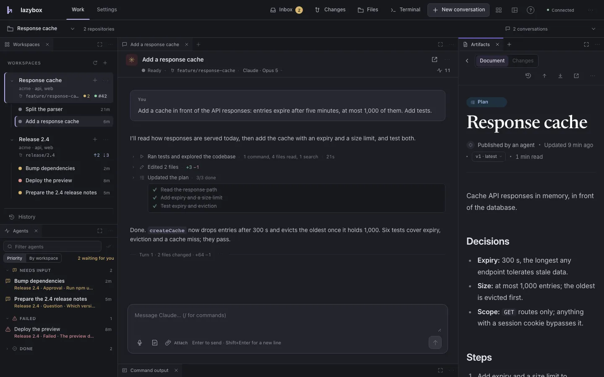
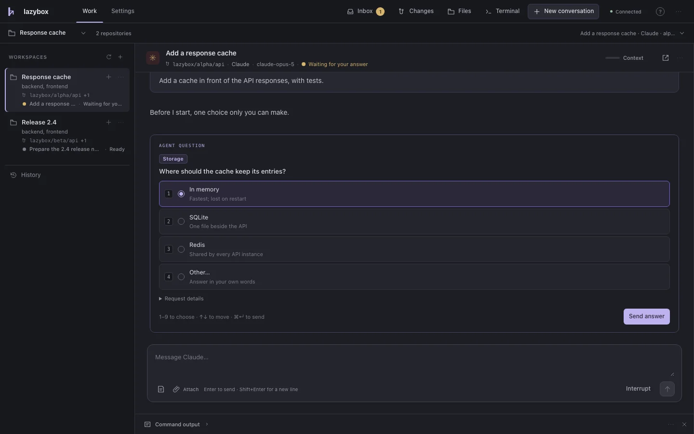
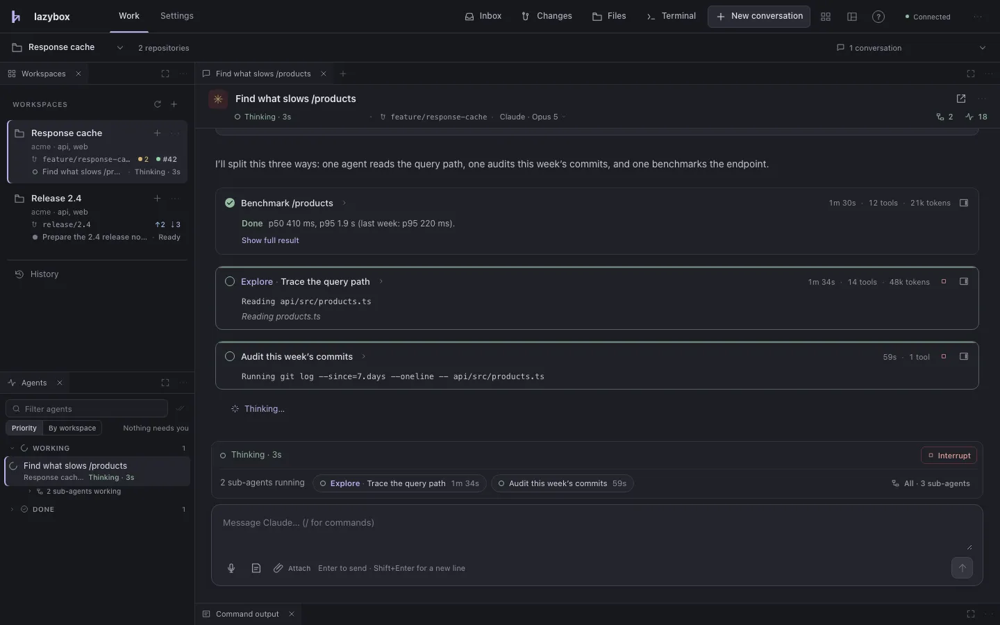
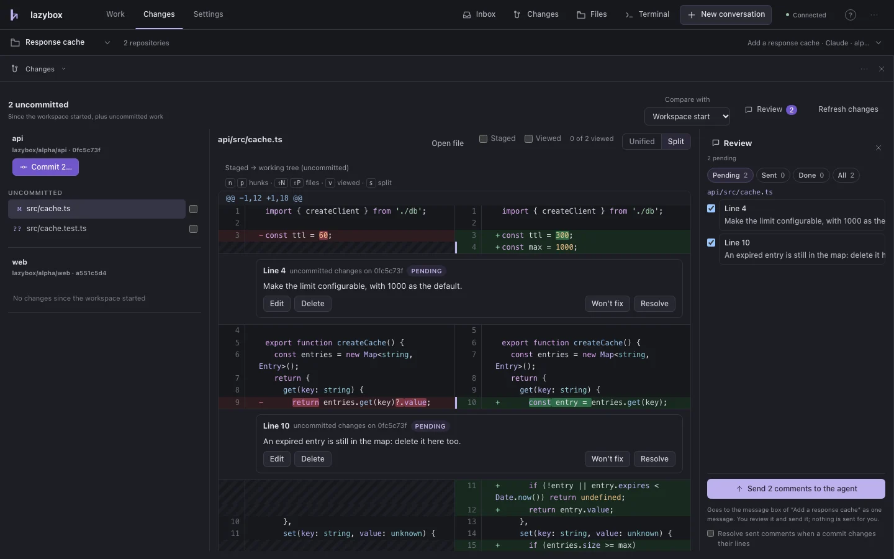
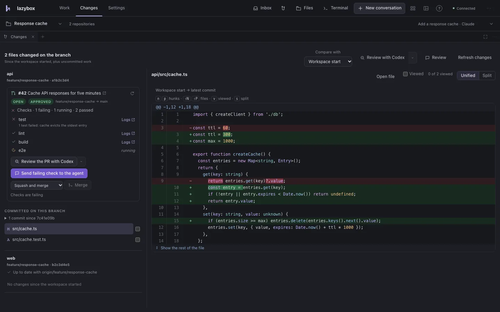
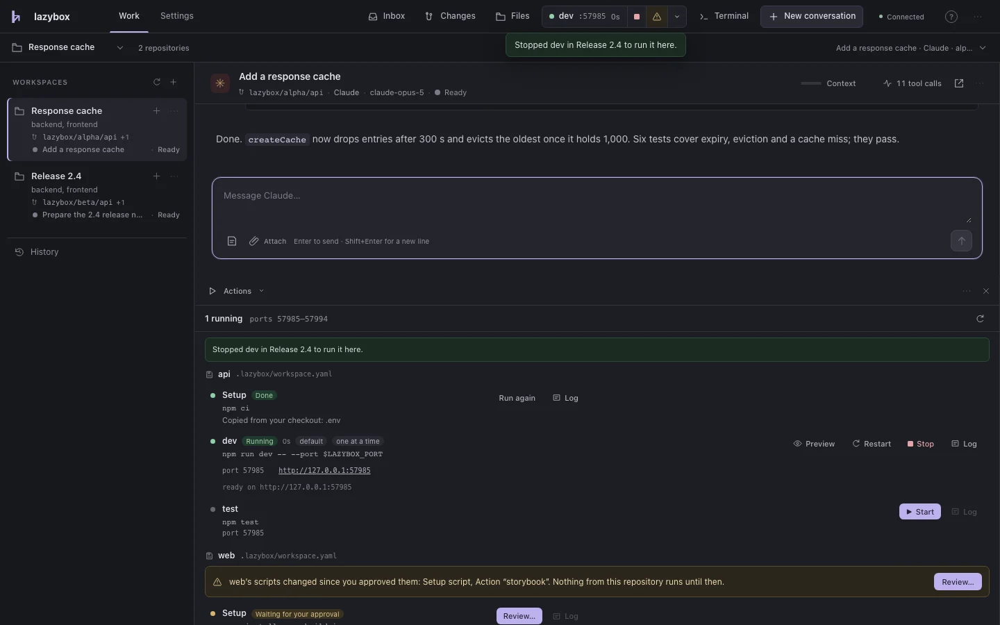
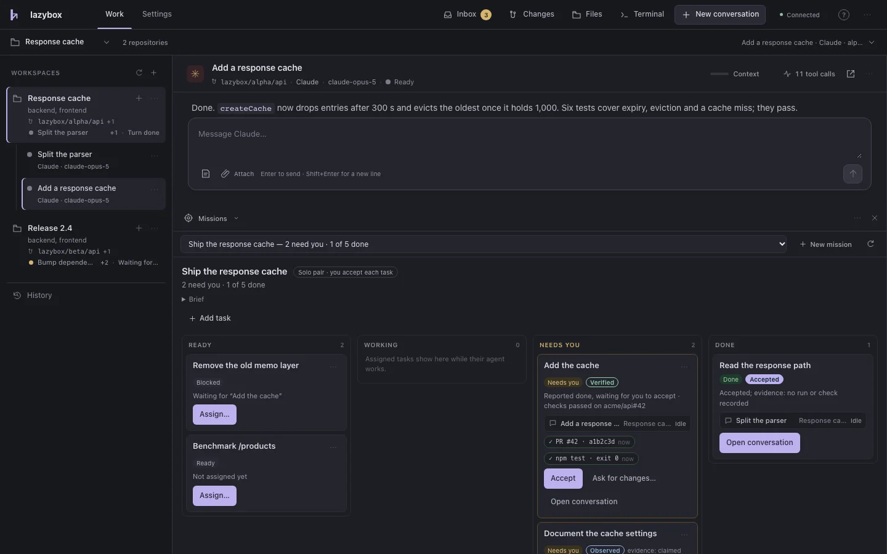

# Lazybox V2

**One window for all your coding agents, across all your workspaces — and the
place you check their work before it lands.** Lazybox V2 is for people who run
Claude and Codex all day: it keeps every agent of every workspace in view, shows
what each one actually did, and keeps them running when the app or its Runner
restarts.

> **Preview.** V2 is built from source on macOS; there is no installer yet. The
> `lazybox` on Homebrew is V1, the terminal PR inbox
> ([its docs](https://lazybox.ai/docs/)).



## What you get

**Many agents, one window.** Workspaces of one or several repositories, each
in its own git worktrees, each with as many Claude or Codex conversations as you
like. The inbox (`]] i`) and `⌘J` take you to whichever needs you next; toasts,
sounds and notifications tell you when.

**A chat at least as good as the agent's own terminal.** Questions as option
cards, approvals that show exactly what will run, with *Allow once*, *Always
allow* and *Deny with a reason*. Tool calls fold into readable lines; sub-agents
are live cards you can open or stop. [Work in the chat →](docs/guides/chat.md)

 

**Verify before you trust.** Review every change in a split diff, leave inline
comments the agent receives as one message, undo any agent turn from its
checkpoint, then commit, push, open the pull request, watch its checks and
merge — without leaving the app. [Review an agent's work →](docs/guides/review-agent-work.md)

 

**Missions with evidence** *(preview)*. Split a goal into tasks across
conversations; Lazybox records the runs, commits and checks behind each one, so
*claimed* and *verified* never look the same. [Missions →](docs/guides/missions.md)

**Run your app per workspace.** A committed `.lazybox/workspace.yaml` gives every
workspace its setup, its dev server on its own ports, and a Preview beside the
chat; a Web panel browses docs and PRs in place. [Run your app →](docs/guides/run-your-app.md)

 

**Agents outlive everything.** Close the window, restart the Runner, install a
new build: agents and the commands they started keep running, and Lazybox picks
them up where they were.

**And:** several subscriptions with automatic switching at a limit
([guide](docs/guides/subscriptions.md)) · versioned plans and reports as
[artifacts](docs/guides/artifacts.md) · your phone as a remote, paired by QR
code over Tailscale *(preview)* ([guide](docs/guides/phone.md)) · light, dark and your own
themes ([guide](docs/guides/appearance.md)) · a `lazybox`
CLI that does what the app does, plus your own actions and hooks in one YAML
file ([guide](docs/guides/automate.md)).

## Install (preview)

On macOS, with Git, Go 1.27+, Node 24+, Rust 1.90+, the Codefly CLI, and Claude
Code and/or Codex installed:

```sh
git clone https://github.com/AntoineToussaint/lazybox.git && cd lazybox
git switch feat/v2-command-output
make -C v2 deps
make -C v2 stage                          # builds and checks a release; prints its id
make -C v2 promote RELEASE=<that id>
make -C v2 working                        # opens Lazybox; keep this terminal open
```

Or `make -C v2 dev` to run **Lazybox Dev** straight from your checkout, with its
own data. Details and prerequisites: [Getting started](docs/getting-started.md#install-preview).

## Quick start

1. **Welcome.** The first launch offers to connect a subscription (your `claude`
   or `codex` sign-in already works) and to add a repository.
2. **First workspace:** `]] w`, find your repositories (a local folder, or GitHub
   with a personal token), select, **Create workspace**.
3. **First agent:** `]] c`, choose Claude or Codex and *Ask for approval*,
   **Start**, and type what you want.
4. **Check its work:** `]] d` opens Changes.

| Key | Does |
| --- | --- |
| `⌘K` | Command palette — every action, conversation, workspace and file |
| `⌘J` / `⇧⌘J` | Next / previous conversation that needs you |
| `⌘1` … `⌘9` | Go to workspace 1…9 |
| `]]` | The leader: from the message box, opens a menu of every next key |
| `?` | All shortcuts, with your keys |

## Documentation

**[The V2 docs](docs/README.md)** — getting started, concepts, guides,
[keyboard shortcuts](docs/reference/keyboard-shortcuts.md),
[the CLI](docs/reference/cli.md),
[configuration files](docs/reference/configuration.md),
[troubleshooting](docs/troubleshooting.md) and the [FAQ](docs/faq.md).

## Contributing

`make -C v2 dev` for a hot-reloading Dev app, `make -C v2 check` before you
push, `make -C v2 help` for every target. Design notes, audits, the roadmap and
test evidence are indexed in [internal docs](docs/internal/README.md);
repository-wide rules are in [AGENTS.md](../AGENTS.md) and
[CONTRIBUTING.md](../CONTRIBUTING.md). Questions and bugs: [SUPPORT.md](../SUPPORT.md);
security reports: [SECURITY.md](../SECURITY.md).
