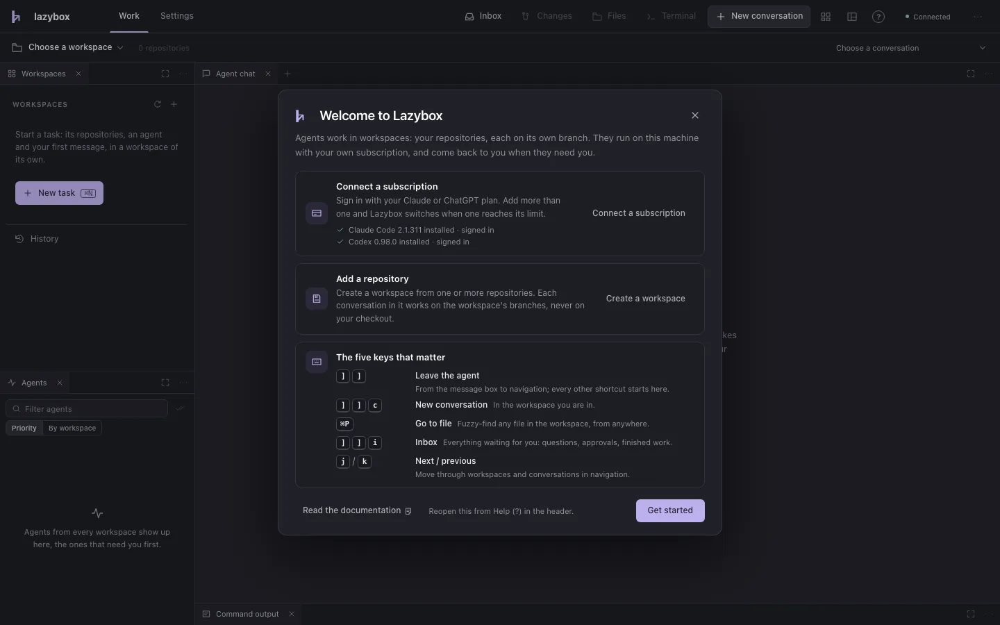
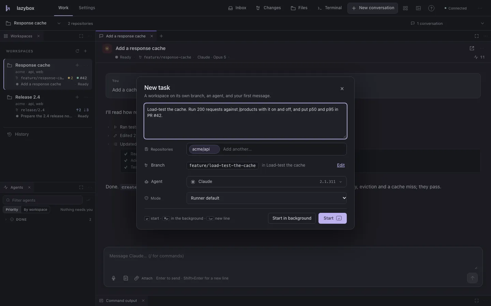
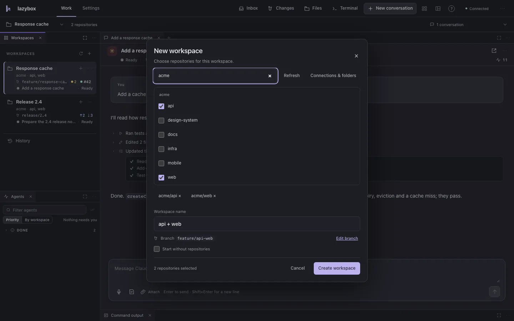
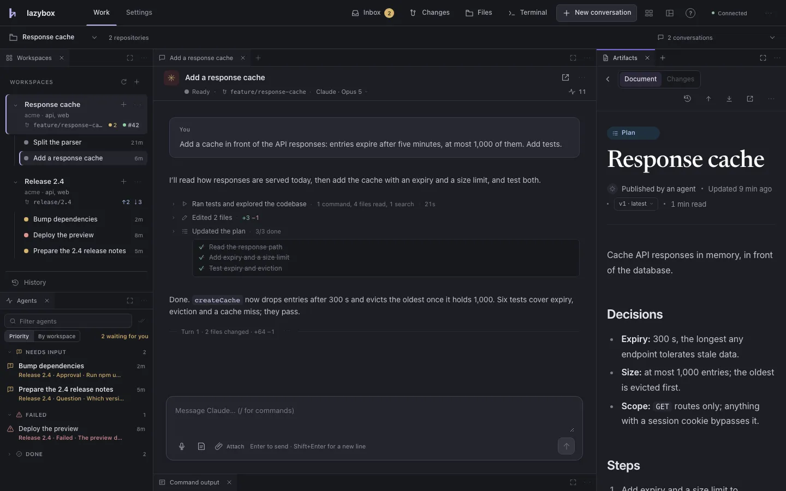
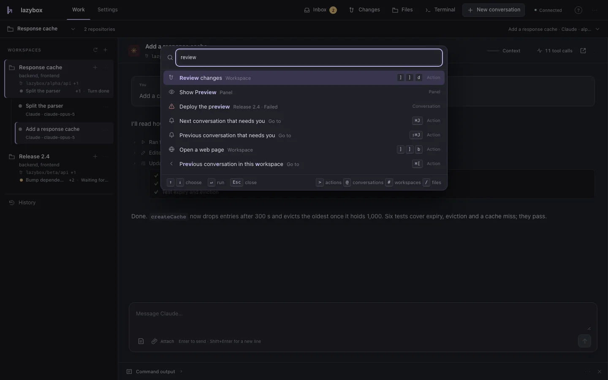

# Getting started

Ten minutes from a clone to an agent working in its own workspace.

- [Install](#install)
- [Build from source](#build-from-source)
- [First launch](#first-launch)
- [Your first workspace](#your-first-workspace)
- [Your first agent](#your-first-agent)
- [The keys that matter](#the-keys-that-matter)
- [Use the CLI from your terminal](#use-the-cli-from-your-terminal)
- [Next steps](#next-steps)

## Install

Lazybox is a Mac app for Apple Silicon. Download the disk image from a
release, drag **Lazybox** to Applications and open it (or
`brew install --cask AntoineToussaint/lazybox/lazybox-v2`). The first launch
explains and sets up its background service, the **Runner**, and offers to
put the `lazybox` command on your PATH. It brings its own Runner, Claude
worker and Node; you need `git` and the agents you use (Claude Code, Codex)
signed in. Updates arrive in the app. Everything else — where things are,
unsigned builds, uninstalling — is in [Install](install.md).

No release is published yet. Until then, build it from source.

## Build from source

On **macOS** (the desktop app has only been built and tested there).

**You need**

| Tool | Version | Why |
| --- | --- | --- |
| Git | any recent | worktrees for every workspace |
| Go | 1.27 or newer | the Runner and the `lazybox` CLI |
| Node.js / npm | 24+ / 11+ | the app's interface and the Claude worker |
| Rust | 1.90 or newer | the native desktop app (Tauri) |
| [Codefly](https://github.com/codefly-dev) CLI | current | builds and supervises the Runner |
| Claude Code and/or Codex | installed | the agents themselves; sign in once, or add accounts later in Settings |
| Tailscale | optional | only to [pair your phone](guides/phone.md) |

**Build and launch**

```sh
git clone https://github.com/AntoineToussaint/lazybox.git
cd lazybox
git switch feat/v2-command-output        # V2 lives on this branch for now
make -C v2 deps                          # npm dependencies, once

# Freeze a build you will use day to day ("Working"):
make -C v2 stage                         # builds, runs the release checks, prints a release id
make -C v2 promote RELEASE=<that id>
make -C v2 working                       # opens Lazybox; keep this terminal open
```

`stage` runs the full release check suite, so the first one takes a while.
To try Lazybox straight from your checkout instead, run `make -C v2 dev`: it
opens **Lazybox Dev**, a separate app with its own Runner and data, which
reloads as the source changes.

Keep the launcher's terminal open. Closing the window leaves the Runner — and
your agents — running; `Ctrl+C` in the launcher stops the Runner. Agents keep
running even then, and the next Runner picks them up again.

> **Working and Dev are separate.** Each has its own workspaces, conversations
> and GitHub connection, so experimenting in Dev never disturbs your real work.
> See [the internal notes](../ENVIRONMENTS.md) for where each keeps its data.

## First launch



On a fresh install Lazybox greets you once with the three things it needs:

1. **Connect a subscription.** Opens Settings → Subscriptions. Your existing
   `claude` or `codex` sign-in already works as *Local CLI sign-in*; add named
   accounts here if you have several (see [Subscriptions and limits](guides/subscriptions.md)).
2. **Add a repository.** Opens the New workspace picker (next section).
3. **Five keys** — shown with *your* bindings. They are also
   [below](#the-keys-that-matter).

You can reopen the welcome any time from **Help (?) → Welcome and getting
started**. After an update, a quiet card in the corner lists **What's new**.

## The fastest start: New task (`⌘N`)



`⌘N` (File → New Task…, or **New task** where the window is empty) opens one
sheet: type what the agent should do, pick the repositories (recent ones
first; type to search), check the branch it suggests from your message (Edit
to change it or the workspace's name), the agent and how it works (Ask for
approval, Plan first, Read only, YOLO). **Enter** creates the workspace on its
branch and the conversation, and sends your message; **⌘Enter** does it in
the background so you can start the next one. The sheet remembers your last
repositories, agent and mode; Escape keeps an unsent message for next time.
*Start without a repository* makes an empty workspace. The steps below do the
same one at a time.

## Your first workspace

A **workspace** is a named place to work: one or several repositories, each
checked out as its own git worktree, plus every conversation about that work.



1. Press `]] w` (or **New workspace** in the sidebar).
2. **Find your repositories.** The picker searches everything Lazybox knows:
   - **A folder of checkouts:** *Connections & folders → choose a folder*.
     Lazybox scans it once and remembers what it found. No GitHub needed.
   - **GitHub:** *Connections & folders → Connect with a personal token*. The
     form links to GitHub with the right scope (`repo`) already set; the output
     of `gh auth token` works too. Nothing is cloned until you create a workspace.
3. **Select** one or more repositories, accept or edit the name, and
   **Create workspace**. Progress streams while the Runner clones (once) and
   creates the worktrees. Double-clicking a repository creates the workspace at
   once.

Your original checkouts are never changed. Add more repositories later with
the workspace's **Add repositories…** action.

If a repository has a committed [`.lazybox/workspace.yaml`](reference/configuration.md#lazyboxworkspaceyaml-setup-and-actions),
Lazybox asks you to **review its scripts** before running its setup — see
[Run your app](guides/run-your-app.md).

## Your first agent



1. Press `⌘⇧N` or `]] c` (or the **+** beside the workspace name).
2. Choose the **agent** (Claude or Codex), the **account**, and the
   **permissions**:
   - **Ask for approval** — the agent asks before running commands or editing.
     The best place to start.
   - **Read only** — it can look, not change.
   - **YOLO** — full access, no prompts. Use it in workspaces you can throw away.

   *Model, gateway & context* holds the rest: a specific model, **Metered ·
   track workspace cost**, a *Plan* workflow, extra instructions.
3. **Start**, then type what you want and press `Enter` (`Shift+Enter` for a
   new line). Drop files or paste a screenshot to attach them.

While it works, the bottom of the conversation shows one live line: the step
in words, the command it runs, and **Interrupt**. When it needs you — a question
or an approval — the conversation says so, the inbox counts it, and you get a
notification if Lazybox is in the background.

Close the window whenever you like: **the agent keeps running**, on the Runner.
Reopen Lazybox and it is exactly where it was.

Next: [work in the chat](guides/chat.md) and [review what it did](guides/review-agent-work.md).

## The keys that matter

| Key | What it does |
| --- | --- |
| `⌘K` | **Command palette.** Every action, conversation, workspace, file, setting and panel, by name. Start here when you don't know a key. |
| `⌘J` | **Next conversation that needs you**, across all workspaces (`⇧⌘J` goes back). |
| `⌘1` … `⌘9` | Jump to the Nth workspace in the sidebar. |
| `]]` | **The leader.** From the message box, leaves typing and opens a menu of every next key: `]] c` new conversation, `]] d` changes, `]] f` go to file, `]] i` inbox, `]] s` snippets… |
| `?` | **All shortcuts**, with your current keys, filterable (`⌘/` works while typing). |



Prefer a tmux-style `Ctrl+b` prefix or plain arrows? Settings → Shortcuts has
both presets, and every key can be changed. The full list is in
[Keyboard shortcuts](reference/keyboard-shortcuts.md).

## Use the CLI from your terminal

Everything you do in the window is scriptable with the `lazybox` command. Build
it once and put it on your `PATH`:

```sh
make -C v2 build-go                      # writes v2/bin/lazybox
export PATH="$PWD/v2/bin:$PATH"          # add to your shell profile to keep it
lazybox ls                               # workspaces, conversations, live state
lazybox inbox                            # what needs you
```

It finds the running Working or Dev Runner by itself. If you also have V1
installed, mind which `lazybox` comes first on your `PATH`: V1's is the
terminal inbox. Agents always get the V2 one. See [the CLI reference](reference/cli.md).

## Next steps

- [Concepts](concepts.md) — the model in one page.
- [Review an agent's work](guides/review-agent-work.md) — Changes, comments,
  checkpoints, pull requests.
- [Run your app](guides/run-your-app.md) — a dev server per workspace, previewed
  beside the chat.
