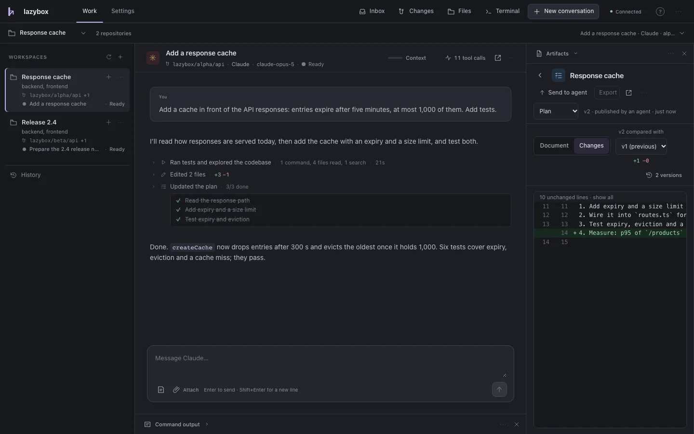

# Artifacts

Agents write plans, reviews and specs — in a chat message, or in a file such as
`docs/PLAN.md`. Track one as an **artifact** and it becomes a versioned page of
the workspace: compare versions, export it, and hand it back to an agent.

## Track something

| From | How |
| --- | --- |
| **An agent's message** | Hover the message and click **Track**, or right-click → **Track as artifact…**. The title and kind (plan, report, spec, notes) are suggested, with a preview. Later messages of the same conversation offer **Update "Title" from this message…**, which shows the diff before saving. |
| **A Markdown file** | In Files, right-click the file (or the editor tab) → **Track as artifact**. Lazybox follows the file: each settled change becomes a new version, and the page says *Synced with `api/docs/PLAN.md`*. **Stop syncing with file** keeps every version. |
| **The agent itself** | Agents publish with `lazybox artifact put PLAN.md --title "Migration plan" --kind plan`; their briefing tells them to. |

## Read and compare

Open the panel with `]] a` (or Page actions ⋯ → Show panel → Artifacts). The
list shows each artifact's kind, latest version, who made it and when. On the
page:

- **Document** — the rendered Markdown; Mermaid blocks render as diagrams.
- **Changes** — the diff between the shown version and any earlier one.
- **History** — every version with its origin (*you*, *the agent*, *file
  changed on disk*) and time.

The page follows new versions by itself. Rename by double-clicking the title.

## Use it

- **Send to agent** puts a reference in the message box of the conversation
  beside the page — title, version, an outline, and the command that prints the
  whole text. You decide when to send.
- **Open in its own window** for a second screen.
- **Export:** Copy as Markdown, Download .md, Print or save as PDF, **Save to
  repository…** (written but never committed — review it in Changes), or
  **Create GitHub issue…** in a workspace repository.

Deleting a workspace deletes its artifacts; deleting a conversation does not.
