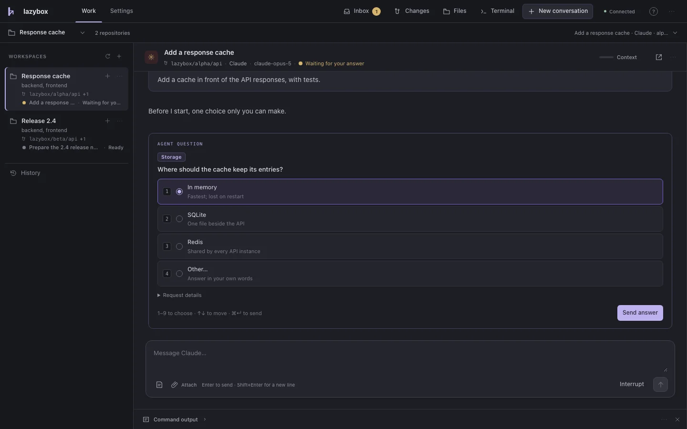
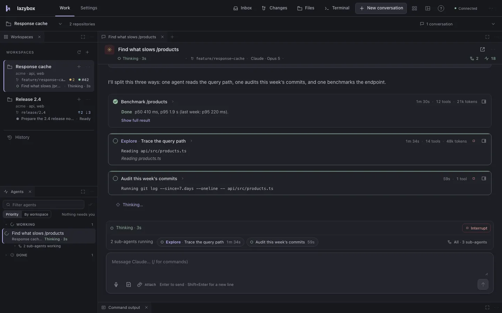

# Work in the chat

The chat replaces the agent's own terminal interface, so everything you would
do there — answer, approve, steer, stop — is here, plus a clearer view of what
it did.

- [Send, steer and stop](#send-steer-and-stop)
- [Answer questions and approvals](#answer-questions-and-approvals)
- [Follow what it does](#follow-what-it-does)
- [Sub-agents and background commands](#sub-agents-and-background-commands)
- [What it costs](#what-it-costs)
- [Reuse your prompts and snippets](#reuse-your-prompts-and-snippets)
- [Peek without leaving the page](#peek-without-leaving-the-page)

## Send, steer and stop

- `Enter` sends, `Shift+Enter` starts a new line. A message sent while the agent
  works is **queued** and delivered when the turn ends. Queued messages wait
  above the message box (*Queued — Claude is busy (Running a command · 5m)*),
  each with **Send now**, which stops the agent's current step and sends yours
  next in one click (its tooltip names the step it stops), and, for
  Codex, **Steer**, which hands it to the running turn without stopping it.
  Claude cannot take a message mid-turn, and the strip says so. After Send
  now the conversation shows one quiet line, *Stopped to send your message*,
  and your message goes as soon as the step stops, the other queued messages
  in order after it. A message never waits while the agent is idle, even
  after Lazybox restarted.
- **Dictate** instead of typing: hold `Right ⌥` (or `⌥Space`) and speak, or click the
  microphone in the message box — see [Voice](voice.md).
- **Attach** files with the paperclip, by dropping them on the chat, or by
  pasting a screenshot. Up to four files, 20 MiB per message. Images show as
  thumbnails; hover one to see it larger.
- **Interrupt** (in the live bar at the bottom) stops the running turn. An
  interrupt is never treated as an error: send your next message and the agent
  carries on.
- **Permission** can change mid-conversation from the session menu (⋯):
  Ask for approval, Read only or YOLO.
- **Model** too: the session menu lists the provider's models with the current
  one marked, and the model name in the chat header opens the same picker. The
  switch is live; an agent started before live switching restarts between turns
  and the conversation continues (**Restart now**).
- **End session** stops the agent but keeps the conversation; sending a new
  message resumes it. **Delete conversation…** removes it.

## Slash commands

Type `/` at the start of the message box for a menu of what you can run, in
three groups. It filters as you type; `↑`/`↓` choose, `Tab` completes, `Enter`
runs and `Esc` closes it and leaves your text. It works in Vim insert mode too.

- **Lazybox** commands do the real thing and send nothing: `/model <name>`,
  `/permissions ask|read-only|yolo`, `/subscription`, `/compact` (the agent
  summarizes its context; the conversation shows "Compacted context: 156k → 61k
  tokens"), `/clear` (a new conversation in this workspace; this one is kept),
  `/cost` and `/context` (the usage popover), `/review` (the review tray),
  `/artifact` (track the agent's last message), `/mission`, `/run` (the last
  command block), `/stop`, `/detail quiet|smart|verbose`, `/rename <title>` and
  `/help`. A command that takes a choice lists it (models, modes) with the
  current one marked; one that cannot run now says why. They are in the command
  palette (`⌘K`) as well.
- **The agent's own** commands — Claude's built-ins and your project's or your
  own `.claude/commands` — with their descriptions and argument hints. Choosing
  one completes `/name ` for its arguments; `Enter` sends it as the prompt and
  the agent runs it. (Codex's app-server does not list custom prompts.)
- **Snippets** by name: choosing one inserts it; those the last one sent chains
  to (`next:`) come first.

A switch of model or permissions, or a compaction, leaves one quiet line in the
conversation rather than a message. A message that merely starts with a slash
(`/usr/local/bin is missing`) is sent as written; an unknown `/word` asks
"Not a command — send as text?" first, and `Enter` again sends it.

## Answer questions and approvals

When the agent needs you, the conversation shows a card, the inbox counts it,
and it moves to the top of the **Agents** list under Workspaces. Right-click
any conversation, in any list, for Open beside, Peek, Rename, Pin, Mark as
read, Stop, Archive and Delete.

**Questions** show their options as cards: click, or press `1`–`9`; `↑` `↓`,
`Space` and `Enter` work too. *Other…* lets you answer in your own words.
Several questions are answered together and sent with `⌘↵`.

**Approvals** show exactly what will run: the command (highlighted) and its
folder, or the diff of a file edit, with risk hints such as a recursive
delete, a download piped to a shell, network access, or a path outside the
workspace. Then:

| Answer | Key | What happens |
| --- | --- | --- |
| **Allow once** | `y` | Runs this call only. |
| **Always allow …** | `a` | Allows this kind of call for this conversation or this workspace, at a scope the provider supports. |
| **Deny** | `n` | Optionally tell the agent what to do instead; it receives your reason. |

Keys work while the chat has focus, never while you are typing.

## Follow what it does

- **The header** names the conversation and says how it is going. The title
  is a few words the agent gives it when its first turn ends (turn this off in
  Settings → Agents & workspaces → *Name conversations after their first
  turn*), and until then a cut of your first message that never stops inside a
  word. **Double-click** the title (or press `F2` on it, or ⋯ → **Rename…**) to
  name it yourself: your name always wins and is what the sidebar, the Agents
  list, the inbox, tabs, peek and the palette show. A click shows the first
  message whole. The line under it has the status, the branch, the agent and
  model (click to switch), the subscription when you have more than one, then
  the numbers — prompts, background work, context and cost, tool calls — with
  their words in the tooltips. In a narrow panel what does not fit moves, whole,
  into **⋯**.
- **Tool calls are one line each** — *Read src/a.ts*, *Ran npm test*, *Edited
  3 files +12 −4* — expandable in place to the command, its output, or the diff.
  How much you see is your choice: [Activity detail](activity-detail.md).
- **Edits** show their first changed lines without a click.
- **The plan** (Claude's to-do list, Codex's plan) is a live checklist in the
  conversation; older plans fold to one line.
- **Thinking** is one quiet line: *Thinking…*, then *Thought for 4s*.
- **The live bar** at the bottom of a running conversation says what is
  happening now, in words, with the command and the folder it runs in, the last
  lines of its output, and the right stop button (**Stop command** for a
  command Lazybox runs, otherwise **Interrupt**). A server or watcher the agent
  started with `lazybox run` in the foreground (it listens on a port, looks
  like a server, or has been quiet for 20 seconds) offers **Move to
  background**: the agent's turn goes on and the command keeps running, in
  Command output and Processes. Agents' `lazybox run` does this by itself after
  20 seconds. For the agent's own shell step that may never end, the bar
  suggests interrupting and asking it to use `lazybox run`.
- **What Lazybox tells the agent** is an event, never a message from you: one
  line with an icon — *Added authority to this workspace* `feature/revenge`
  (its path on hover and behind the copy button), *Codex review · 3 findings
  sent*, *Codex asked Claude: …*, *Task assigned · …* — that opens to exactly
  the text the agent received. Events that follow each other read as one
  block. Lazybox's messages are not among the prompts `↑` recalls or `⌥↑`
  jumps to.
- **Runner restarts** that interrupted nothing leave only a small mark (its
  count and last time on hover), one until you next send a message. A restart
  that left something uncertain — a message it could not confirm, a command
  whose outcome is unknown — is one quiet line saying what to do.
- **Each finished turn** ends with a quiet marker: *Turn 2 · 3 files changed*,
  with **Show changes in this turn** and **Revert to before this turn…** in its
  menu. See [checkpoints](review-agent-work.md#undo-a-turn-checkpoints).
- **Activity** in the chat header opens the full, searchable history of every
  tool call, with Running and Failed filters.
- **Command output** (`]] o`) is the console of the commands the agent ran —
  every byte, while the agent itself received a compact view.

Links in the agent's answer work: a `path:line` opens the file in the Editor
(`⌥`-click opens a quick look instead), and `⌥`-click on a web link opens it in
a [Web panel](run-your-app.md#browse-beside-your-work-the-web-panel).

## Run the commands it gives you

A shell block in the agent's answer (`bash`, `sh`, `zsh`, `console`…) has
**Run** beside **Copy**:

- **Run** asks the agent to run it: *Run this and tell me the result:* and the
  block go as their own message, so your draft stays. The agent runs it, sees a
  failure and reacts. While a turn is running it waits behind it (*Queued —
  runs after the current turn*). The block then says how it went: *Sent to
  Claude · ran ✓* or *failed ✗*.
- **Run myself…** (the **▾** next to Run, or the block's right-click menu)
  shows the exact script, which you can edit, and the folder to run it in: the
  workspace or one of its repositories. `Enter` runs it, `Esc` cancels. A
  script with a placeholder such as `<your-token>` waits until you fill it in.
  It runs in [Command output](#follow-what-it-does), and the block shows
  *Running*, *✓ exit 0* or *✗ exit 2*; after a failure, **Ask Claude to fix**
  adds the script and the end of its output to your message.
- **A server or watcher** (`npm run dev`, `docker compose up`, `--watch`…)
  never ends, so nothing waits for it: **Run** asks the agent to start it in
  the background and tell you when it is ready, and **Run myself** starts it in
  the background. The block then reads *Running · port 3000* with **Open
  preview** and **Stop**. If a workspace action runs the same command, Run
  myself starts that action instead, on the workspace's own port.

Focus a block (`Tab`) and press `Enter` to run it through the agent, `⌥Enter`
to run it yourself. `]] r` runs the latest block of the conversation. Commands
an agent writes inline, such as `make lint`, offer the same two in their
right-click menu. Nothing runs without your click or key. In a read-only or
Plan conversation, Run myself still works — it runs as you — and says so first.

## Sub-agents and background commands

A sub-agent is a card where its parent started it: its task, live state, the
step it is on (*Reading platform/bin/devbox*), elapsed time, tool count and
tokens; once it ends, its outcome and the result it handed back. Open a card to
follow its own messages and tool calls in a panel docked beside the chat, or
floating. Stop one sub-agent from its card (Claude) without stopping the rest.

Beside the message box, one chip per running sub-agent or background command
takes you to it; **All**, and the background-work button in the chat header,
list everything that ran. Each kind is counted apart (*2 sub-agents · 17
commands · 0 running · 1 failed*), newest first, sub-agents as a tree under
who started them; older finished items fold behind **Show 12 earlier**, but
anything running or failed always shows. A background command (Claude's
`run_in_background`) is not a sub-agent: it reads as what the agent said it
does (*Generate the protobuf code*), whole, with what runs beneath it, and
opens a panel with its script and the output the agent last read.

## Continue in Claude Code or Codex

When you need something of the provider's own CLI that Lazybox does not map
(`/mcp`, a plugin, its own plan mode), **Continue in Claude Code…** (or
**Continue in Codex…**) in the conversation's ⋯ menu and its right-click menu
copies its resume command, in its folder — `cd <folder> && claude --resume
<id>` or `codex resume <id>` — to paste in your terminal. Let the agent finish
its turn here first. A conversation on a subscription Lazybox keeps apart from
your own CLI sign-in says so instead: its history is in that subscription's
private folder.

## What it costs

The usage popover in the chat header (`/cost`) shows the context window once
the agent has reported usage (before that the header shows no meter; `/context`
still opens it) and the conversation's **token cost**: input, cache read, cache write and output,
each with its tokens and what it cost, then the total and how much of the
input the prompt cache served. The cost is an API-equivalent estimate, not a
bill. Usage without a price says which model and why — a model with no price
yet (add one in Settings → Pricing), a provider that reports only a running
total for the session (Codex without the metered gateway), a fee Lazybox does
not price — and how many tokens that leaves out.

## Reuse your prompts and snippets

- **Recall:** `↑` in an empty message box brings back what you sent, newest
  first — this conversation's, then every other's — like a shell; `↓` walks back.
- **Jump to a prompt:** the marker rail and `⌥↑` / `⌥↓` move between your own
  messages in a long conversation.
- **Snippets** (`]] s`, or the snippet icon in the message box): a searchable
  picker over Lazybox's snippet catalog with a preview of the exact text.
  `Enter` sends it, `Shift+Enter` inserts it into your draft. Recent and
  favourite snippets come first.
- **Your own leader keys:** Settings → Shortcuts can add `]]` menu entries that
  send or insert a snippet with one key.

## Peek without leaving the page

`⌥`-click a row — a conversation, an inbox item, a process, a command, a file —
or focus it and press `Space`, and it opens live in an overlay over the page:
a conversation's latest messages with a message box, a command's output, a
file's content. `←` / `→` step through the neighbouring rows, `⌘↵` opens it for
real, `Space` or `Esc` closes it.
