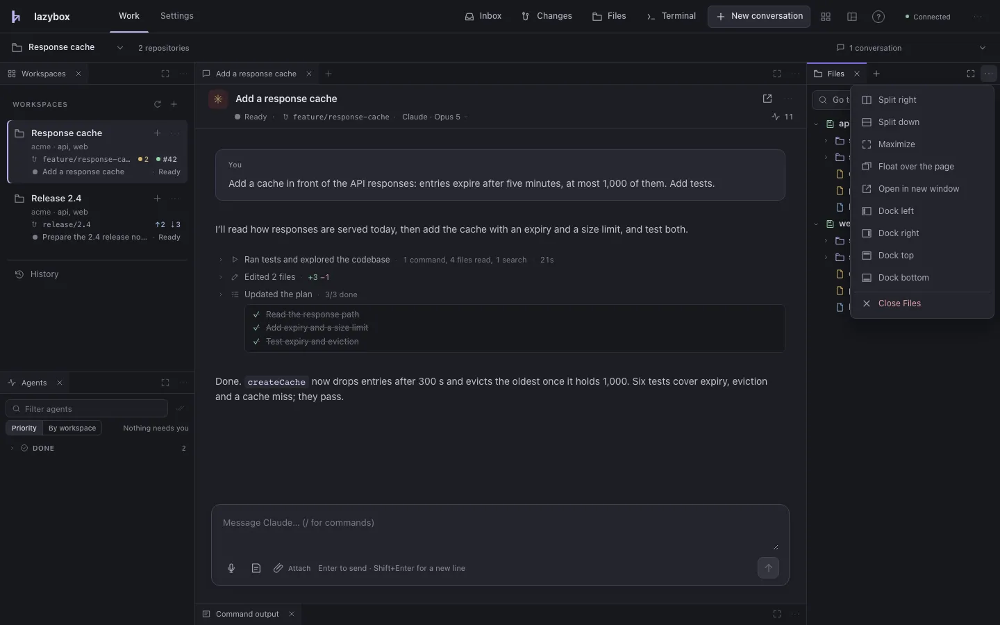
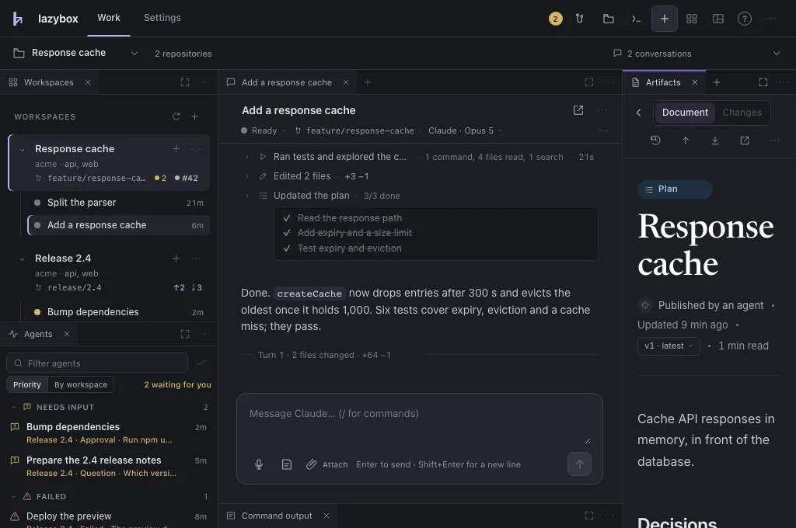

# Layouts and docking

Each workspace has its own **pages** (the tabs at the top of the workspace), and
each page holds **panels**: the conversation, Changes, Files, the Editor, Command
output, a Terminal, a Web panel, Artifacts, Missions, Processes and more. Every
workspace remembers its own pages, arrangement and drafts.

## Move, fold and close a panel

From the panel's own header — no edit mode needed:

| To… | Do this |
| --- | --- |
| Dock it to an edge | **⋯ → Dock left / right / top / bottom**, or **drag the header** onto one of the four edge zones (`Esc` cancels). |
| Fold it | Click its **title**: it collapses to its header (or a narrow tab beside another panel). Click again to unfold. |
| Resize it | Drag the divider between panels. |
| Close it | **×**. Bring it back from the **Panels** menu in the header. |

**Inside panels**, drag the divider between a list and what it shows: the
Changes file list and its review tray (and, when Changes is narrow, the Files /
Review column), the Artifacts list and its version history, the Settings
sections, the Documentation's pages, the snippet list and the agent browser's
steps. The divider lights up under the pointer; double-click it for the default
size. From the keyboard, Tab to it: `←` `→` (`↑` `↓` for the browser's steps)
move it 16 px, `⇧` with them 64 px, `Home` and `End` take it to its narrowest
and widest. Drag the Changes file list, the Artifacts list or the
Documentation's pages all the way in, or press `Enter` on the divider, and the
list folds to a thin rail: click it, press `Enter` or drag it out to bring it
back. Each divider keeps its size in the window, in every workspace and after a
restart, and never leaves the content beside it too narrow to read. A phone
keeps its stacked layouts, without dividers.

**Agents**, under Workspaces, belongs to the window rather than to a page:
closed or folded, it stays that way in every workspace, on every page and
after a restart, with the sidebar keeping its width, until you bring it back
from **Panels → Agents** (or the palette, or `⌃⌥⇧Esc`).

The **+** right after a group's tabs (or `⌘T` for the active group) starts a
conversation in that group, or opens any panel there as its front tab; a panel
already shown elsewhere on the page moves there.

Lazybox remembers the edge you last used for each kind of panel: a terminal you
moved left opens on the left next time, in every workspace. The workspace list
and the conversation are what the page is for, so they stay; everything else
docks around them. On a phone, panels show one at a time from the panel
switcher.

In a small window every panel keeps a width it can be read at: the header's
buttons keep only their icons, Workspaces and Agents stay on screen, and a
panel that would be crushed becomes a tab beside another instead.

## From the keyboard

Everything above works without the mouse. The *active group* is the one you
last clicked or focused; while you use these keys a ring shows it, and a screen
reader hears where the focus went.

| To… | Press |
| --- | --- |
| Focus the group to the left, right, above or below | `⌥⌘` + arrow |
| Move the active panel into that group (or swap two lone panels) | `⌥⇧⌘` + arrow — with no group that way, a tab splits out to that side |
| Move the active group's edge that way | `⌃⌘` + arrow — 5 % a press, faster held down; the sidebar's edge sets its width |
| Bring a tab of the active group to the front | `⌃1`–`⌃8`, `⌃9` for the last |
| Split the active panel | `⌘\` — a lone panel asks what goes beside it |
| Maximize or restore it | `⇧⌘M` |
| Cycle through the groups | `⌃⇥`, `⌃⇧⇥` |

A maximized panel stays maximized: moving the focus takes the zoom along, and
`⌘J`, `⌘]` or opening a conversation shows it maximized. In the file editor,
`⌥⌘←` / `⌥⌘→` stay its own tab keys, and in code `⌥⌘↑` / `⌥⌘↓` add a cursor.

**Lost?** `⌃⌥⇧Esc` puts back the default layout *and* the default keys at once,
with **Undo** in the corner. It is the one shortcut you cannot change. Every key
here can be changed in Settings → Shortcuts; the full list, with the Windows and
Linux keys, is in [Keyboard shortcuts](../reference/keyboard-shortcuts.md#layout).

## Pages

**Page actions (⋯) → Customize page** opens the page editor: **Add panel**,
**Duplicate page**, **Rename page**, **Remove page** and **Reset pages** (up to
eight pages, twelve panels each). The only panel of a page has a **×** that
closes the page with it.

**Layout configuration** (same menu) shows the page as JSON: copy it to keep a
layout, paste one and **Import layout** to apply it. It holds panel references
and their arrangement only — never accounts or permissions.

## Windows

Use a second screen:

- **Open workspace window** (Page actions, or the palette: *Open this workspace
  in a new window*) opens the whole workspace in its own window. Closing it ends
  nothing.
- A conversation's session menu → **Open in its own window**.
- An artifact → **Open in its own window**; a Web panel → **⋯ → Move to a new
  window**, and back.

To put a panel back where it was, use **Put back in main window** at the top of
its window, press `⇧⌘D` there, or just close the window. In the main window,
**In other windows** under the header lists what is away: **Show** brings that
window forward, **Put back** returns it, **Put all back** returns them all. The
command palette (`⌘K`) has *Put all windows back* and *Put … back in main
window* for each one.

A conversation shows in at most one chat panel per page; choosing a conversation
reuses the page's chat panel.

## Peek instead of switching

To glance at another conversation, process, command or file without changing
your layout, `⌥`-click its row (or focus it and press `Space`): it opens in an
overlay you can move and resize. See [Peek](chat.md#peek-without-leaving-the-page).
