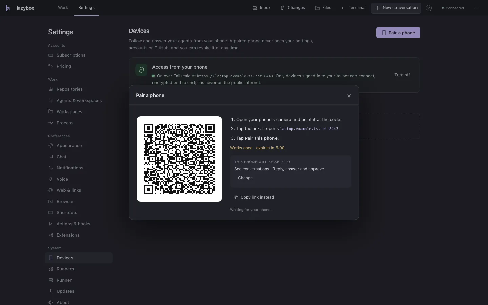
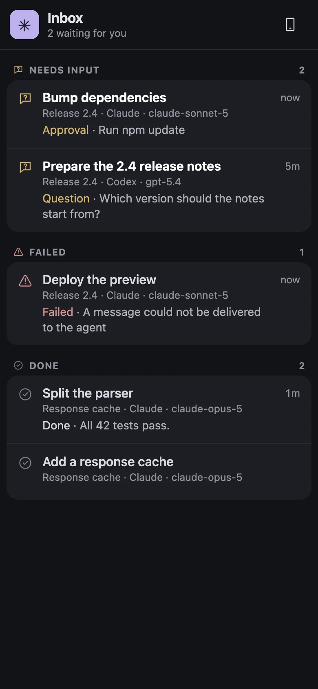

# Pair your phone

> **Preview.** Your phone can follow and answer your agents from anywhere on
> your Tailscale network. There are no push notifications and no native app yet;
> the phone uses a web page.

## What you need

- [Tailscale](https://tailscale.com) on the Mac running Lazybox and on your
  phone, signed in to the same tailnet, with **HTTPS certificates** turned on
  for the tailnet.
- Funnel **off** for the port Lazybox uses (Lazybox refuses to serve through
  Funnel: your Runner is never reachable from the public internet).

## Pair

1. **Settings → Devices → Access from your phone → Turn on.** Lazybox serves its
   phone gateway on your tailnet over HTTPS. If something is missing — Tailscale
   not installed or signed in, certificates off, the port taken, Funnel on — the
   card says exactly what.
2. **Pair a phone.** A QR code appears with what the phone will be allowed to do
   (*See conversations · Reply, answer and approve*); **Change** adds *Start
   conversations* or removes replying. The code works **once, for five
   minutes**; closing the dialog withdraws it.
3. **On the phone**, scan the code with the camera. Check what it will be able
   to do, name it, and **Pair this phone**. Both screens then show the same key
   fingerprint — check they match.

## Use it

The phone opens on an **inbox** of every conversation across workspaces,
grouped by what it needs: *needs input*, *failed*, *ready for review*,
*working*, *done*. Open one to read the transcript, **Allow** or **Decline** an
approval, answer a question, send a message, or **Interrupt** a running turn.
The tab's title carries the number of conversations waiting for you.

## Revoke

Settings → Devices lists each paired phone with its permissions, fingerprint,
pairing date and when it was last seen. **Revoke** signs it out at its next
request.

## What a phone can never do

Change settings, subscriptions or GitHub, open terminals, run commands, edit
files, delete anything, restart the Runner, manage devices — or change an
agent's permission mode, even with every grant. A phone's access token lasts 15
minutes and its key cannot be copied out of the phone's browser.

Not yet: push notifications, access from outside your tailnet, reviewing diffs
on the phone, starting a conversation from the phone (the permission exists; the
screen does not).
