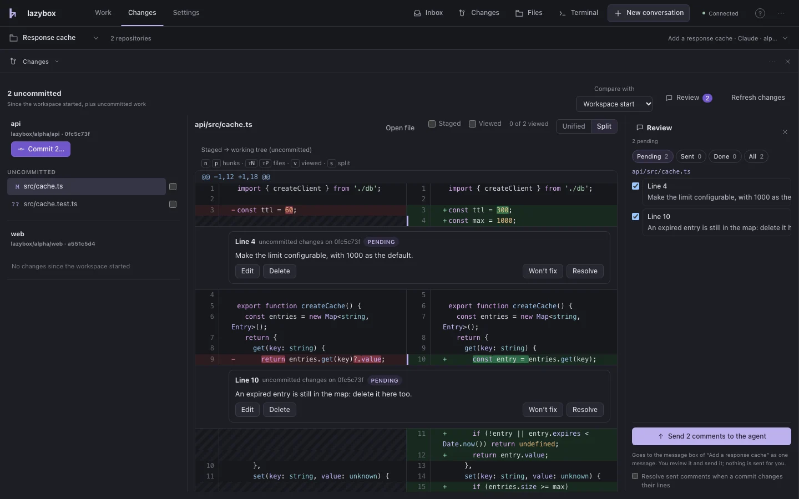
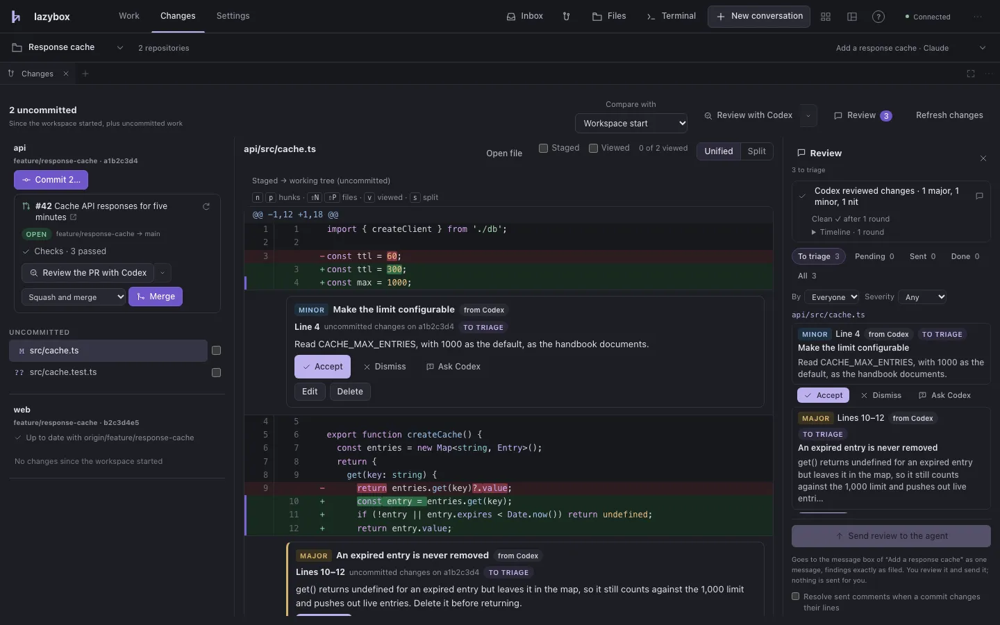
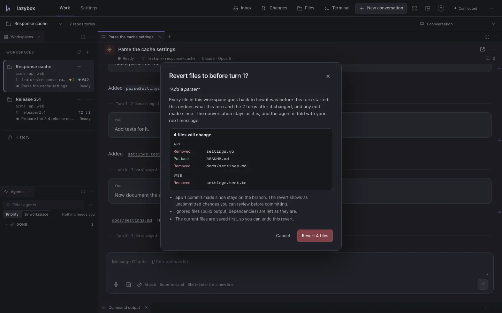
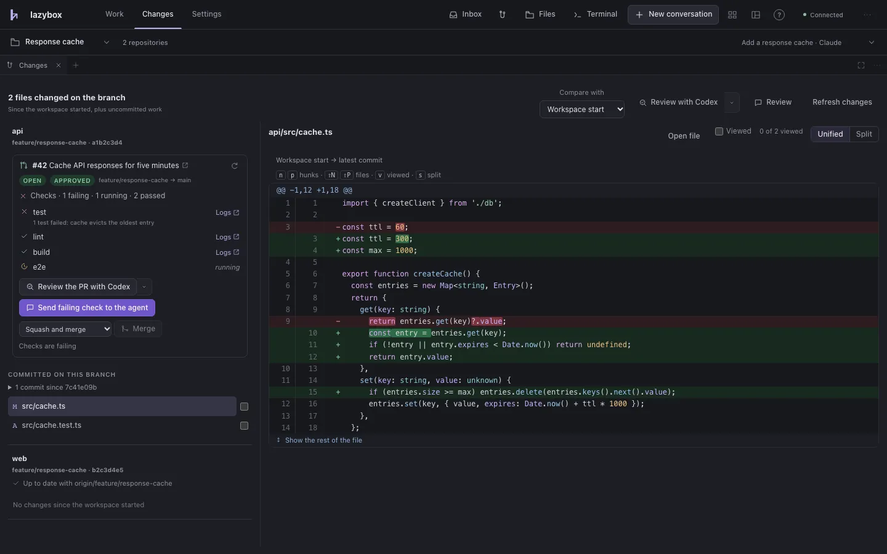

# Review an agent's work

When an agent says it is done, Lazybox gives you five tools to check: the
**Changes** page, **review comments** it can act on, **another agent's
review**, **checkpoints** to undo a turn, and the **PR loop** to land it.

- [Read the changes](#read-the-changes)
- [Comment, and send the comments to the agent](#comment-and-send-the-comments-to-the-agent)
- [Let another agent review it](#let-another-agent-review-it)
- [Undo a turn: checkpoints](#undo-a-turn-checkpoints)
- [Commit, push, open and merge a pull request](#commit-push-open-and-merge-a-pull-request)

## Read the changes

Press `]] d` (or **Review changes** in the workspace header). Changes shows every
repository of the workspace, each on its own, with its changed files and their
diffs. No GitHub connection is needed for any of it.

- **Compare with** picks what you see: uncommitted changes, staged changes, the
  branch since the workspace started, against the default branch or any other
  branch — or **one agent turn** (before → after).
- **Unified or split** (`s`): side by side, with the words that changed marked
  inside each line. Long unchanged runs fold; click a fold to read the lines.
  A pane narrower than 700px shows unified.
- **Viewed** boxes per file (`v` ticks one and moves to the next). A file whose
  diff changes again is unticked for you.
- **Move fast:** `n` / `p` next and previous hunk, `Shift+N` / `Shift+P` next
  and previous file.

## Comment, and send the comments to the agent

Every diff takes inline comments, like a pull request review — but the reviewer
receiving them is your agent.

1. **Comment:** hover a line and click **+**; drag down the **+** column, or
   Shift-click a second line, for a range. Removed lines take comments too.
   Comments are Markdown; `⌘↵` saves.
2. **Collect:** **Review** in the Changes header opens the tray with every
   comment of the workspace, by file, filtered *Pending*, *Sent*, *Done* or *All*.
   In a narrow Changes panel the tray and the file list share the left column:
   switch with the **Files** and **Review** tabs above it.
3. **Send:** **Send N comments to the agent** puts **one message** in the chosen
   conversation's message box — each comment with `repo/path:line`, the quoted
   lines and whether they are still current. Untick any you want to keep back.
   **Nothing is sent until you press Enter**; the comments are then marked *Sent*.
4. **Close the loop:** Resolve, Won't fix, Edit, Delete or Reopen from each
   thread. Optionally, *Resolve sent comments when a commit changes their lines*.

Comments follow the code: one whose lines moved re-anchors (*moved*); one whose
lines are gone is *outdated*, with the original lines still quoted. They are
kept by the Runner, so every window sees them and they survive restarts.

> Not yet: publishing comments to GitHub as a PR review, replies inside a
> thread, comments from the Editor.

## Let another agent review it

**Review with Codex** in the Changes header (or **Review with Claude**: by
default the other agent than the one that did the work) starts a second
agent on what the page compares, **read-only**. It is a conversation of its
own in the workspace, briefed with the goal, the plan, the diff and the test
runs; you can talk to it like any other.

- **Its findings land in the Review tray**, *To triage*, each with its
  severity (blocker, major, minor, nit), a title and the lines it is about —
  and as a card on those lines in the diff. Filter by severity or author.
- **Triage:** **Accept** makes a finding a pending comment; **Dismiss** asks
  why and keeps the reason; **Ask Codex** opens the reviewer's conversation
  with a follow-up about that finding.
- **Send** them with your own comments, as above: the author receives each
  finding exactly as filed. Nothing is sent for you.
- The author's conversation shows the review while it runs, then what it
  found, with **Open review**.

Other ways in: a turn's ⋯ menu (**Review this turn with Codex**), the pull
request card (**Review the PR with Codex**), ⌘K, and `/review` in the message
box. **Settings → Agents & workspaces → Review by another agent** picks the
default reviewer, whether findings go back to the author between rounds, and
can review every turn that changes files.

## Undo a turn: checkpoints

Before every agent turn, and again after it, Lazybox saves a checkpoint of every
repository in the workspace — committed, uncommitted and untracked files —
without touching your branch, index or stash.

- Each finished turn ends with a quiet marker: *Turn 3 · 4 files changed ·
  +40 −12*. Its menu (⋯) holds the actions below.
- **Show changes in this turn** opens Changes on exactly that turn.
- **Revert to before this turn…** previews which files will be restored,
  removed or put back, and what stays (commits made since stay on the branch).
  Then it saves your current state first, and restores.
- **Undo revert** (in the confirmation toast and on the turn's marker) puts
  everything back. The conversation is kept, and the agent is told with your
  next message that files were reverted.

Revert waits while any agent in the workspace is mid-turn. Ignored files,
files over 32 MiB, and repositories added after the turn are not part of a
checkpoint. Each conversation keeps its latest 100 turns.

## Commit, push, open and merge a pull request

Above each repository's files, Changes shows **the one next step**, in bold:
**Commit N…**, then **Push** (or **Publish branch**), then **Create PR…**, then
the pull request's card. Nothing happens without your click.

| Step | What you get |
| --- | --- |
| **Commit…** | The changed files, all ticked (untick to leave some out), and a message drafted from the conversation. **Ask the agent to write it** asks the agent that did the work for a message. **Commit & push** does both. |
| **Push** | Pushes the branch under its own name. Never forced; a diverged remote branch is refused and explained. |
| **Create PR…** | Title and description prefilled from the commits, the default branch as base, a draft option. Unpushed commits are pushed first. |
| **The card** | State, review decision, and every check, failing first, each with its **Logs**. Refreshes on its own while checks run. |
| **Send failing checks to the agent** | Puts the failing checks, their results and log links in the conversation's message box. You decide when to send. |
| **Merge** | Squash, merge commit or rebase — offered only when GitHub says the PR is green and mergeable; otherwise the card says why. Merges only the head you see. |

Commit and push work with any git remote. Pull requests need a GitHub
connection: Settings → Repositories → *Connections & folders* → **Connect with
a personal token** (a classic token with `repo` scope covers everything; `gh auth
token` works too).
