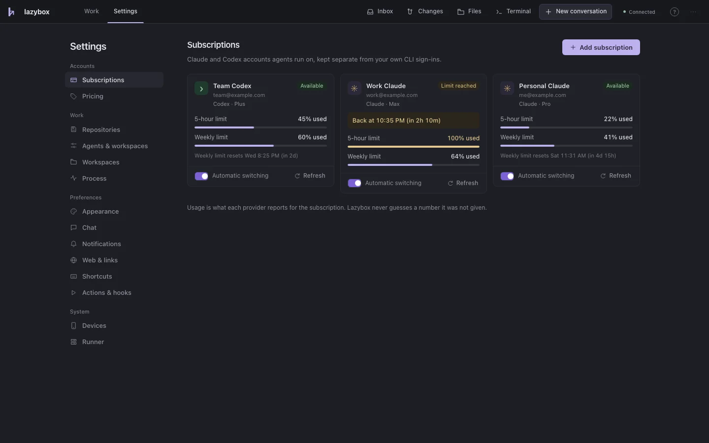

# Subscriptions and limits

Lazybox runs Claude and Codex on your own subscriptions. Use one, or several —
and when one hits its limit, the conversation can continue on another.

## Your accounts

- **Local CLI sign-in** — the account your `claude` or `codex` command already
  uses. It works with no setup.
- **Named subscriptions** — Settings → Subscriptions → **Add subscription**:
  choose Claude or Codex, name it ("Work Claude"), and choose **Continue in
  your browser**. The provider's sign-in page opens; finish there and Lazybox
  continues by itself (**Open again** if you closed the page, **Cancel** to
  stop). Each account is stored separately from your CLI login and from each
  other, and is kept for next time. Browser sign-in needs the browser on the
  same computer as the Runner.

### Signing in to Codex with a code

For Codex, **Use a code instead (for another device)** shows a one-time code
to enter at ChatGPT on any device, such as your phone. Some ChatGPT accounts
do not allow codes: Lazybox then says that device-code sign-in is off for the
account (in a Business or Enterprise workspace, an admin turns it on) and
offers **Sign in with the browser instead**, which always works.

Codex listens on your Mac for the browser to say you are signed in, so only
one Codex browser sign-in can wait at a time: starting one ends a `codex
login` still waiting in a terminal. If Codex cannot listen because other
sign-ins hold its ports, Lazybox says another Codex sign-in is in progress:
finish or close it and try again, or use a code instead.

Each card shows the plan, the usage windows the provider reports (for example
the five-hour and weekly windows) and when they reset. **Refresh** asks the
provider again without starting any work. A limited account reads *Back at
6:00 PM*.

## When a conversation hits a limit

**Automatic switching is on by default.** A new conversation may move to any
other signed-in subscription of the same provider when it reaches a limit. It
stays the same conversation: Lazybox hands the work over and the chat shows one
quiet line — *Switched to Work Claude · Personal resets at 6:00 PM*.

When it cannot switch on its own, one card offers the choices:

- **Continue with** the best other subscription (or pick one);
- **Wait for reset** — it resumes by itself at the reset time while the window
  is open;
- **Always switch automatically**.

Messages you send while a conversation waits are kept and delivered once it can
continue. You can also switch at any time from the session menu (⋯) →
**Switch subscription…**.

## Control it

| To… | Do this |
| --- | --- |
| Keep one conversation on its account | Untick **Switch subscriptions automatically** when you start it (CLI: `--no-rotate`). |
| Never switch onto an account | Turn off **Automatic switching** on its card in Settings → Subscriptions. |
| Turn switching on for conversations already running | The limit card's **Always switch automatically**, or the session menu. |
| Track cost per workspace | Choose **Metered · track workspace cost** under *Model, gateway & context* when starting a conversation; the Usage & cost panel and the chat's usage line then count it. Settings → Pricing holds the rates. |

More in [Troubleshooting → limits](../troubleshooting.md#an-account-hit-its-limit).
