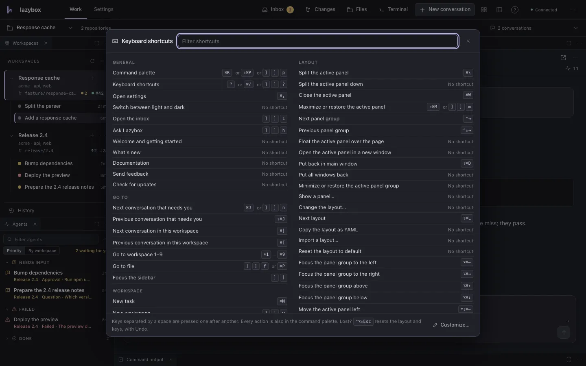

# Keyboard shortcuts

<!-- GENERATED FILE — do not edit by hand.
     Regenerate with: npm run docs:shortcuts (from v2/)
     Source: packages/surfaces/src/actions.ts, rendered by scripts/docs-shortcuts.ts. -->

Every command in Lazybox is declared once, in the action registry. The keys
below are its **defaults**; the in-app overlay (`?`) always shows *your* keys.

- **Change a key:** Settings → Shortcuts. Pick a preset — **Vim** (`]]` and
  `h j k l`, the default), **Ctrl+b** (a tmux-style prefix with arrows) or
  **Arrows** — then edit any binding. The Ctrl+b preset replaces every `]]`
  below with `Ctrl+b`.
- **Forgot a key?** `⌘K` opens the command palette: every action is there by
  name, with its key beside it. An action with no key (—) runs from the palette.
- **`]]` is the leader.** From the message box, `]]` leaves typing and shows a
  menu of every next key; a single `]` is still text. Settings → Shortcuts can
  add your own entries to that menu (one key sends or inserts a snippet), and
  [your actions](configuration.md#actionsyaml-your-actions-and-hooks) can take a
  key there too.
- On Windows and Linux, read `Ctrl` for `⌘`.

## General

Work from anywhere in the window, including while a dialog is open for the palette and the shortcuts overlay.

| Action | macOS | Windows / Linux |
| --- | --- | --- |
| Command palette | `⌘K` or `⇧⌘P` or `]] p` | `Ctrl+K` or `Ctrl+Shift+P` or `]] p` |
| Keyboard shortcuts | `?` or `⌘/` or `]] ?` | `?` or `Ctrl+/` or `]] ?` |
| Open settings | `⌘,` | `Ctrl+,` |
| Switch between light and dark | — | — |
| Open the inbox | `]] i` | `]] i` |
| Ask Lazybox | `]] h` | `]] h` |
| Welcome and getting started | — | — |
| What's new | — | — |
| Documentation | — | — |

## Go to

Move between conversations and workspaces. Chords with ⌘ (Ctrl) work even while you type in the message box.

| Action | macOS | Windows / Linux |
| --- | --- | --- |
| Next conversation that needs you | `⌘J` or `]] n` | `Ctrl+J` or `]] n` |
| Previous conversation that needs you | `⇧⌘J` | `Ctrl+Shift+J` |
| Next conversation in this workspace | `⌘]` | `Ctrl+]` |
| Previous conversation in this workspace | `⌘[` | `Ctrl+[` |
| Go to workspace 1…9 | `⌘1` … `⌘9` | `Ctrl+1` … `Ctrl+9` |
| Go to file | `]] f` or `⌘P` | `]] f` or `Ctrl+P` |
| Focus the sidebar | `]]` | `]]` |

## Workspace

Open the parts of the workspace in front.

| Action | macOS | Windows / Linux |
| --- | --- | --- |
| New workspace | `]] w` | `]] w` |
| New conversation | `]] c` | `]] c` |
| Review changes | `]] d` | `]] d` |
| Browse files | `]] e` | `]] e` |
| Open a terminal | — | — |
| Show artifacts | `]] a` | `]] a` |
| Open a web page | `]] b` | `]] b` |
| Show or hide command output | `]] o` | `]] o` |
| Open this workspace in a new window | — | — |
| Customize this page | — | — |
| Layout configuration | — | — |
| Show missions | — | — |

## Layout

| Action | macOS | Windows / Linux |
| --- | --- | --- |
| Split the active panel | `⌘\` | `Ctrl+\` |
| Split the active panel down | — | — |
| Close the active panel | `⌘W` | `Ctrl+W` |
| Maximize or restore the active panel | `⇧⌘M` or `]] m` | `Ctrl+Shift+M` or `]] m` |
| Next panel group | `⌃⇥` | `Ctrl+⇥` |
| Previous panel group | `⌃⇧⇥` | `Ctrl+Shift+⇥` |
| Float the active panel over the page | — | — |
| Open the active panel in a new window | — | — |
| Minimize or restore the active panel group | — | — |
| Show a panel… | — | — |
| Change the layout… | — | — |
| Reset the layout to default | — | — |

## Conversation

Act on the conversation you last clicked or focused.

| Action | macOS | Windows / Linux |
| --- | --- | --- |
| Open snippets | `]] s` | `]] s` |
| Focus the message box | — | — |
| Cycle activity detail | `]] v` | `]] v` |
| Activity detail: Quiet | — | — |
| Activity detail: Smart | — | — |
| Activity detail: Verbose | — | — |
| Activity detail: Use the default | — | — |
| Run the last command block | `]] r` | `]] r` |
| Run the last command block myself… | — | — |
| Slash commands | — | — |
| Switch model… | — | — |
| Change permissions… | — | — |
| Switch subscription… | — | — |
| Compact the context | — | — |
| Start over in a new conversation | — | — |
| Show context and token cost | — | — |
| Open the review tray | — | — |
| Track the last reply as an artifact… | — | — |
| Interrupt the agent | — | — |
| Rename the conversation… | — | — |

## Voice

Hold the key and speak; release to finish (a quick tap keeps listening until you press it again). See [Voice](../guides/voice.md).

| Action | macOS | Windows / Linux |
| --- | --- | --- |
| Dictate | `⌥Space` | `Alt+Space` |
| Say a command | `⌥⇧Space` | `Alt+Shift+Space` |
| Stop reading aloud | — | — |

## Sidebar

After `]]` puts the keyboard in the sidebar. The *Arrows* preset uses the arrow keys instead.

| Action | macOS | Windows / Linux |
| --- | --- | --- |
| Next entry | `j` | `j` |
| Previous entry | `k` | `k` |
| Workspace / left pane | `h` | `h` |
| Open entry / agent | `l` | `l` |

## Message box

While you type a message.

| Action | macOS | Windows / Linux |
| --- | --- | --- |
| Send message | `↵` | `↵` |

## Keys inside a panel

These work while the panel or card has focus, never while you type in a text field.

| Where | Keys |
| --- | --- |
| Message box | `Enter` sends · `Shift+Enter` new line · `↑` in an empty box recalls your sent messages, `↓` walks back · `⌥↑` / `⌥↓` jump between your prompts in the conversation |
| Approval card | `y` allow once · `a` always allow (at the first scope offered) · `n` deny, with an optional reason · `1`–`9` pick a row |
| Question card | `1`–`9`, `↑` `↓`, `Space` and `Enter` pick options · `⌘↵` sends the answers |
| Changes | `n` / `p` next / previous hunk · `Shift+N` / `Shift+P` next / previous file · `v` marks the file viewed and moves on · `s` switches unified / split |
| Review comment | `⌘↵` saves · `Esc` cancels · `Tab` to a line's **+** then `Enter` starts a comment (`Shift+Enter` extends the range) |
| Inbox | `j` / `k` move · `Enter` opens · `m` marks seen |
| Any row you can peek | `⌥`-click or `Space` peeks it · in the peek `←` / `→` step through rows, `⌘↵` opens it, `Space` or `Esc` closes |
| Sidebar workspace row | `F2` renames |
| File editor | `⌥Z` toggles word wrap · with Vim editing on: `:w`, `:q`, `:wq` |
| Desktop window | `⌘=` / `⌘-` / `⌘0` zoom in, out, reset |
